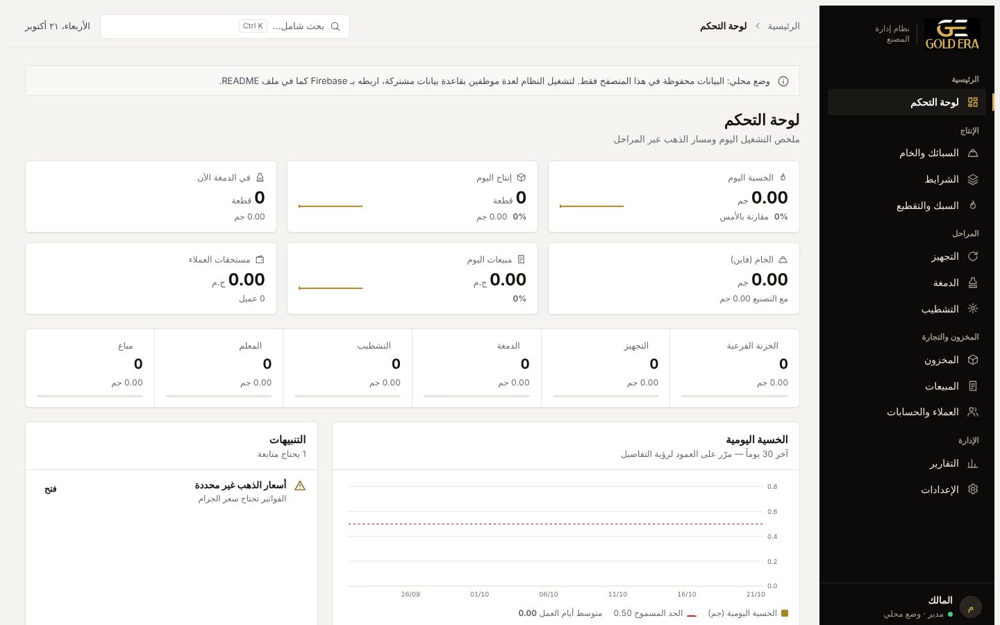

# GOLD ERA ERP

نظام إدارة مصنع GOLD ERA: من استلام السبيكة حتى فاتورة البيع، بنفس دورة الشغل في ملف `FACTORY_.XLSM`.



## الأقسام

| القسم | ماذا يفعل |
|---|---|
| أوامر التصنيع | طلب إنتاج بالصنف والعدد وموعد التسليم، يُربط بالشرايط وصفوف السبك، مع نسبة الإنجاز وتنبيه التأخير |
| العمال والأقسام | بيانات كل عامل (القسم، الكود، الهاتف، تاريخ الالتحاق، الحالة) وأقسام قابلة للتعديل |
| وقت العمل | «بدء» و«إنهاء» لكل عامل مع الشغل والصنف وأمر التصنيع، وتسجيل القطع والوزن عند الإنهاء لحساب الساعات والإنتاجية |
| التقرير اليومي | ما تم في اليوم: صُنع، استُلم وزن، الدمغة، غُلِّف، كُوِّد، بيع — وحالة شغل كل عامل (تلقائية من الساعات والخسية والفرق + تقييم المشرف: كويس/متوسط/مش كويس وملاحظة) |
| لوحة التحكم | الخسية والإنتاج والمبيعات اليوم مع المقارنة بالأمس، مسار القطع عبر المراحل، رسم الخسية لآخر 30 يوماً، والتنبيهات |
| السبائك والخام | استلام السبائك برقمها وعيارها، رصيد الخام والفاين، وكود QR لكل سبيكة |
| الشرايط | صرف شرايط للتصنيع ورد المتبقي للخزنة |
| السبك والتقطيع | نفس معادلات المصنّف: خسية السبك والتقطيع، الوزن الفعلي، الفرق، الوزنة المتبقية — والإنتاج يُرحّل للخزنة الفرعية |
| التجهيز / الدمغة / التشطيب والتغليف | تسليم واستلام ومرتجع بين المراحل، رسوم الدمغة تلقائياً، التغليف بعدد العلب ثم تسليم المعلم، والمتواجد في كل مرحلة |
| المخزون | كل صنف في كل مرحلة بالعدد والوزن والفاين |
| الجرد والتسويات | جرد فعلي لأي مرحلة أو للخام، مقارنته بالرصيد، واعتماد الفروقات كتسويات بسبب مسجل |
| ملصقات QR | دفعات ملصقات للقطع أو العلب بكود فريد لكل ملصق، بمقاس 50×30 أو 40×25 مم أو ورق A4، للطباعة أو التنزيل |
| المبيعات | فواتير بسعر الجرام اليومي + المصنعية، وتنزيل الفاتورة |
| العملاء والحسابات | أرصدة العملاء، التحصيلات، وكشف الحساب |
| التقارير | إنتاجية كل عامل لشهر أو 3 شهور أو سنة أو فترة مخصصة مع تفصيل شهري وتصدير، الملخص الشهري وقائمة الربح التقديري (المصنعية − الدمغة − تكلفة الخسية ± الجرد − المصروفات)، مقارنة 12 شهراً، الخسية يومياً وحسب الصانع، الإنتاج حسب الصنف، سجل التدقيق، وتصدير CSV |
| الإعدادات | الأصناف، العمال، أسعار الذهب، حد الخسية، المستخدمون والأدوار، النسخ الاحتياطي |

كل قيد يُسجَّل باسم من أدخله ووقته. الإلغاء يحتاج سبباً، ولا يُسمح بإلغاء قيد بُنيت عليه حركات لاحقة.

## طريقتا التشغيل

| | الوضع المحلي | وضع Firebase |
|---|---|---|
| الإعداد | لا شيء | مشروع Firebase مجاني (15 دقيقة) |
| البيانات | في هذا المتصفح فقط | قاعدة بيانات مشتركة لكل الموظفين على كل الأجهزة، تتحدث لحظياً |
| المزامنة بين الأجهزة | لا | نعم: الكمبيوتر والموبايل وأي جهاز يدخل بحسابه |
| الدخول | اسم مستخدم وكلمة مرور | اسم مستخدم وكلمة مرور |
| الصلاحيات | نفس النظام، للتجربة على جهاز واحد | تفرضها قاعدة البيانات نفسها (`firestore.rules`) |

يعمل النظام في **الوضع المحلي** طالما `config.js` بدون إعداد Firebase. عند أول فتح يطلب إنشاء حساب المالك.

**المزامنة بين الأجهزة** تأتي من Firebase: كل جهاز يفتح الرابط ويدخل بحسابه يرى نفس البيانات لحظياً، وأي تسجيل من جهاز يظهر على الباقي خلال ثانية. بدون Firebase تبقى البيانات على الجهاز الذي سُجلت عليه فقط.

## المستخدمون والصلاحيات

المالك وحده يُنشئ الحسابات ويحدد الصلاحيات من **الإعدادات ← المستخدمون والصلاحيات**:

1. **مستخدم جديد** ← اسم الموظف، اسم المستخدم (بالإنجليزي)، وكلمة المرور.
2. اختر قالباً سريعاً (مدير، تصنيع وخزنة، المراحل، مشرف عمال، مبيعات وحسابات، مشاهد) أو حدد كل صفحة بنفسك:
   - **مخفية**: لا تظهر في القائمة، ولا يستطيع قراءة بياناتها.
   - **عرض**: يرى الصفحة ولا يسجّل فيها.
   - **عرض وتسجيل**: يرى ويسجّل.
3. صلاحيات خاصة: **إلغاء القيود** و**تعديل الإعدادات** (الأصناف، العمال، الأسعار، الحدود، المصروفات).
4. **حالة الحساب**: «موقوف» يمنع الموظف من الوصول لأي بيانات فوراً.

أعطِ الموظف اسم المستخدم وكلمة المرور، وهو يغيّر كلمة مروره بنفسه من **كلمة المرور** أسفل القائمة.

**كيف تُفرض الصلاحيات:** كل قسم محفوظ في مجموعة مستقلة في قاعدة البيانات (`casting`، `moves`، `sales`…). عند حفظ صلاحيات موظف، يحسب النظام المجموعات التي تحتاجها صفحاته للقراءة، والتي يسجّل فيها، ويحفظها في `access/{uid}`. قواعد Firestore ترفض أي قراءة أو كتابة خارجها، حتى لو حاول الموظف من أدوات المطوّر. الموظف لا يستطيع تعديل صلاحياته.

بعض الصفحات تحتاج بيانات أقسام أخرى لتحسب أرصدتها. مثلاً «المبيعات» تقرأ حركات المراحل لتعرف المتاح لدى المعلم، و«لوحة التحكم» و«المخزون» و«الجرد» و«التقارير» تقرأ كل الأقسام. لا تمنح هذه الصفحات لمن لا يجب أن يرى المبيعات.

## التشغيل على جهازك

الملفات ثابتة بدون أي build. شغّلها من خادم محلي (فتح `index.html` مباشرة لا يحمّل الكتالوج):

```bash
cd gold-era-erp
python3 -m http.server 8000
# ثم افتح http://localhost:8000
```

## النشر على GitHub Pages

النظام موضوع في مجلد `erp/` داخل المستودع `minagoldera-tech/gold-era`، بجانب البرامج الأخرى بدون أي تعديل عليها.

1. في المستودع: **Settings ← Pages ← Build and deployment ← Source: Deploy from a branch ← Branch: `main` / `(root)`** (غالباً مفعّل بالفعل لبرامجك الحالية).
2. الرابط يكون: `https://minagoldera-tech.github.io/gold-era/erp/`

لنشره في مستودع مستقل بدلاً من ذلك: ارفع محتوى المجلد في جذر مستودع جديد، وأضف ملف `.github/workflows/pages.yml` للنشر التلقائي أو استخدم «Deploy from a branch».

## ربط Firebase (لعدة موظفين)

1. ادخل [console.firebase.google.com](https://console.firebase.google.com) ← **Create a new Firebase project** باسم مستقل مثل `gold-era-erp`. لا تستخدم `gold-era-2025`: قواعد الأمان في Firestore واحدة للمشروع كله، وستتعارض مع برامج FADY والمصروفات.
2. **Build ← Firestore Database ← Create database** ← اختر منطقة قريبة (مثل `europe-west`) ← **Production mode**.
3. **Build ← Authentication ← Get started ← Sign-in method ← Email/Password ← Enable** (الخيار الأول فقط).
4. **Authentication ← Settings ← Authorized domains ← Add domain**: أضف `minagoldera-tech.github.io`.
5. **Project settings ← Your apps ← Web (`</>`)** ← سجّل التطبيق وانسخ كائن `firebaseConfig`، والصقه في `config.js` داخل `firebase: { … }`.
6. اسم المالك في `config.js` هو `admin`. لو غيّرته، غيّر `admin@users.gold-era.local` في `firestore.rules` بنفس الاسم.
7. الصق `firestore.rules` كله في **Firestore ← Rules ← Publish**.
8. ارفع التعديلات على GitHub، وافتح الرابط ← **أول تشغيل؟ إنشاء حساب المالك** ← اختر كلمة مرور المالك. **افعل هذه الخطوة فور النشر.** سيُحمَّل كتالوج الأصناف تلقائياً من `data/defaults.json`.
9. أنشئ حسابات الموظفين من الإعدادات.

إعداد Firebase في `config.js` ليس سراً، فهو يظهر لأي متصفح يفتح الموقع. الحماية الفعلية في `firestore.rules`: أي حساب لم يُنشئه المالك ويُحدد له صلاحيات لا يقرأ ولا يكتب شيئاً.

**نسيان كلمة المرور:**
- **الموظف:** أوقف حسابه وأنشئ له حساباً جديداً، أو احذفه من **Firebase ← Authentication ← Users** ثم أعد إنشاءه بنفس الاسم وأعد ضبط صلاحياته. Firebase لا يسمح بتغيير كلمة مرور مستخدم آخر من داخل المتصفح.
- **المالك:** احذف حسابه من Firebase ← Authentication، ثم استخدم «إنشاء حساب المالك» مرة أخرى.

## النسخ الاحتياطي

**الإعدادات ← النسخ الاحتياطي ← تنزيل نسخة احتياطية** يحفظ كل البيانات في ملف JSON واحد. الاستعادة من ملف للمالك فقط. الحسابات وكلمات المرور ليست ضمن النسخة: بعد النقل لـ Firebase أنشئ حسابات الموظفين من جديد.
النسخة نفسها تنقل البيانات من الوضع المحلي إلى Firebase: نزّلها في الوضع المحلي، ثم استعدها بعد ربط Firebase.

لا ترفع ملفات النسخ الاحتياطي على GitHub (`.gitignore` يستبعدها).

## هيكل المشروع

```
index.html              الصفحة الرئيسية وتحميل المكتبات
config.js               إعداد Firebase واسم المالك
firestore.rules         قواعد أمان قاعدة البيانات
src/app.js              الواجهة والمنطق (React 18 + htm، بدون build)
src/platform.js         طبقة البيانات والدخول: Firebase أو التخزين المحلي
src/styles.css          التصميم (نظام GOLD ERA، فاتح وليلي)
data/defaults.json      كتالوج الأصناف الافتراضي من المصنّف
assets/                 الشعار والأيقونة
docs/design-system/     ألوان وخطوط ومبادئ نظام التصميم
.github/workflows/      النشر التلقائي على GitHub Pages
```

### نموذج البيانات (Firestore)

| المسار | المحتوى |
|---|---|
| `settings/catalog` | الأصناف: الاسم، الوزن، العيار، رسوم الدمغة |
| `settings/workers` | العمال وأقسامهم |
| `settings/prices` | سعر جرام 24 و21 و18 |
| `settings/config` | الحد المسموح للخسية اليومية |
| `settings/people` | أسماء المستخدمين لعرض «سجّله» |
| `access/{uid}` | صلاحيات كل مستخدم: الصفحات، ما يقرأه، ما يسجّل فيه، الإلغاء، الإعدادات، الحالة |
| `bars`، `strips`، `casting`، `moves`، `sales`، `payments`، `counts`، `labels` | قيود كل قسم، مستند لكل يوم `YYYY-MM-DD` |
| `orders/{id}` | أوامر التصنيع |
| `months/YYYY-MM` | مصروفات الشهر لتقرير الربح |
| `customers/{id}` | العملاء |
| `staff/{id}` | العمال، و`staff/__departments` قائمة الأقسام |
| `sessions/YYYY-MM-DD` | جلسات وقت العمل: العامل، الشغل، البداية، النهاية، القطع، الوزن |
| `evals/YYYY-MM-DD` | تقييم المشرف اليومي لكل عامل وملاحظته |

الأرصدة كلها (الخام، التصنيع، كل مرحلة، العملاء) محسوبة من القيود وليست مخزنة، فلا تختلف عن السجل أبداً.

## حدود معروفة

- النظام يقرأ كل أيام السجل عند الفتح. الخطة المجانية في Firebase تسمح بـ 50,000 قراءة يومياً، وهذا يكفي سنوات من التشغيل لعدد معقول من الموظفين.
- مسح كود QR بالكاميرا غير مدعوم: اكتب رقم السبيكة أو الصق الرابط في البحث (Ctrl+K).
- الفاتورة تُنزَّل كملف HTML يمكن فتحه وطباعته من المتصفح.
- الربح التقديري يحسب تكلفة الخسية وتسويات الجرد بسعر عيار 24 الحالي في الإعدادات، وليس بسعر يوم حدوثها.
- إنتاج العامل في اليوم يُحسب من «وقت العمل» إذا سُجلت فيه قطع، وإلا من صفوف السبك باسمه — لا يُجمع الاثنان.
- كل ملصق يحمل في كود QR نصاً: GOLD ERA، الكود، الصنف، الوزن، العيار — يقرؤه أي قارئ QR.

## المكتبات

React 18.3.1، htm 3.1.1، qrcode-generator 1.4.4، Firebase 10.12.2 (compat: app وauth وfirestore)، وخط IBM Plex Sans Arabic — كلها من CDN بإصدارات مثبتة.
